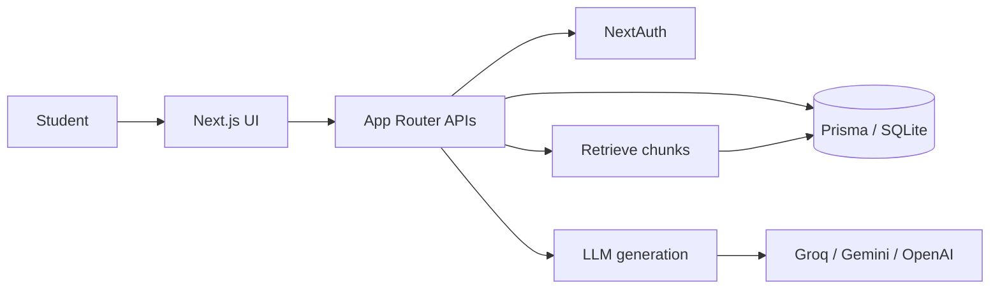

# Architecture

## Problem

Students revise what they already know. Chat-with-PDF tools wait for a question. GapFinder AI diagnoses first: map the syllabus, test from the student’s own material, rate topics, then plan.

## Stack

- Next.js 15 App Router + TypeScript + Tailwind CSS
- NextAuth credentials (demo users)
- Prisma + SQLite (swap `DATABASE_URL` for PostgreSQL / Supabase in production)
- Vector-ready chunk store (JSON embeddings on each chunk, cosine similarity)
- Lexical BM25 retrieval when no embedding key is set
- Generation: Groq, Gemini or OpenAI via the Vercel AI SDK

## System diagram

## RAG pipeline

1. **Ingest.** PDF/text is extracted. Text is split on markdown/syllabus headings, then packed to ~700 characters with overlap.
2. **Index.** Each chunk stores `section`, `content`, source title, and an optional embedding array.
3. **Retrieve.** Query is scored with BM25 over section + content + title. If embeddings exist, cosine similarity is added.
4. **Ground.** Quiz items, evaluations, chat answers and plan copy may only use retrieved chunks. The model is instructed to refuse missing content.

Retrieval and generation are separate functions (`lib/retrieve.ts` vs `lib/ai.ts`). Generation never searches the web and never sees the full corpus, only the top-k chunks.

## AI workflow

| Feature | Retrieval | Generation |
| --- | --- | --- |
| Topic map | Syllabus text | Optional LLM cleanup of headings |
| Diagnostic quiz | Top chunks per topic | MCQ + short questions from those chunks |
| Answer evaluation | Stored citation / expected idea | Optional examiner-style feedback |
| Gap report | Quiz scores by topic | Optional reason rewriting |
| Revision plan | Weak/medium/strong ordering | Optional summary paragraph |
| Explain-this-topic | Top chunks for the question | Answer with `[n]` citations |

Without an LLM key the app still runs: heading-based topics, extractive questions, lexical overlap scoring, and extractive chat answers.

## Data model (core)

User → Materials → Chunks  
User → Topics → Questions → Answers  
Attempt → TopicMastery → RevisionPlan

## Auth and demo

- `judge@gapfinder.ai` / `Demo@123` — student with preloaded Class 12 CS corpus
- `teacher@gapfinder.ai` / `Demo@123` — class gap view

First successful login calls `ensureDemoData()` if the student workspace is empty.

## Limits

- SQLite is local-demo friendly; Vercel serverless needs Postgres.
- PDF extraction is best-effort; markdown/text is the reliable path.
- Question quality depends on retrieval. Short or scanned PDFs will diagnose poorly.
- No multi-language UI yet. No real LMS sync. Class analytics for the teacher demo mix the seeded student with a small overlay.
